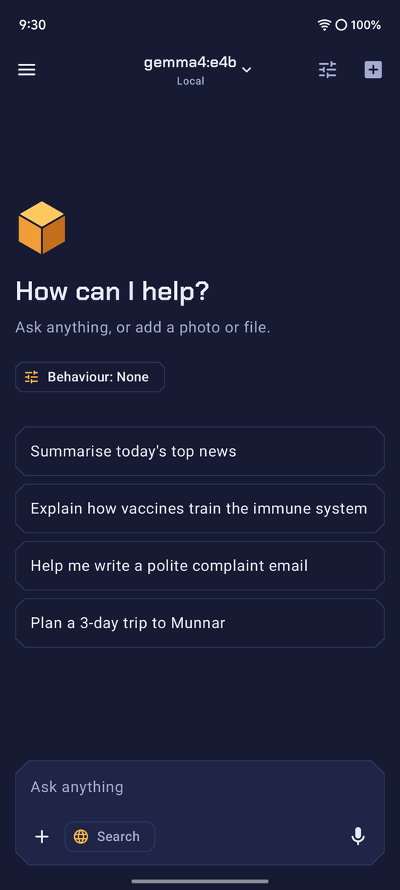
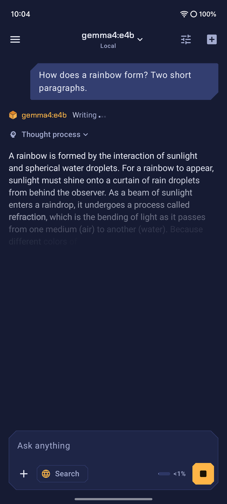
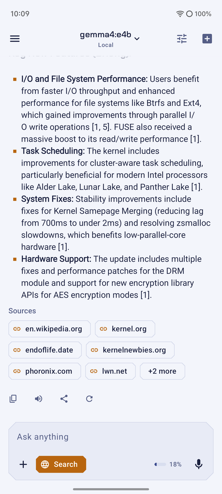
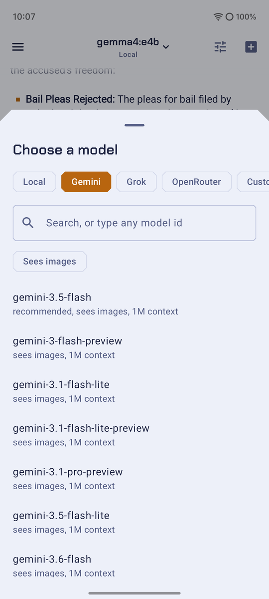
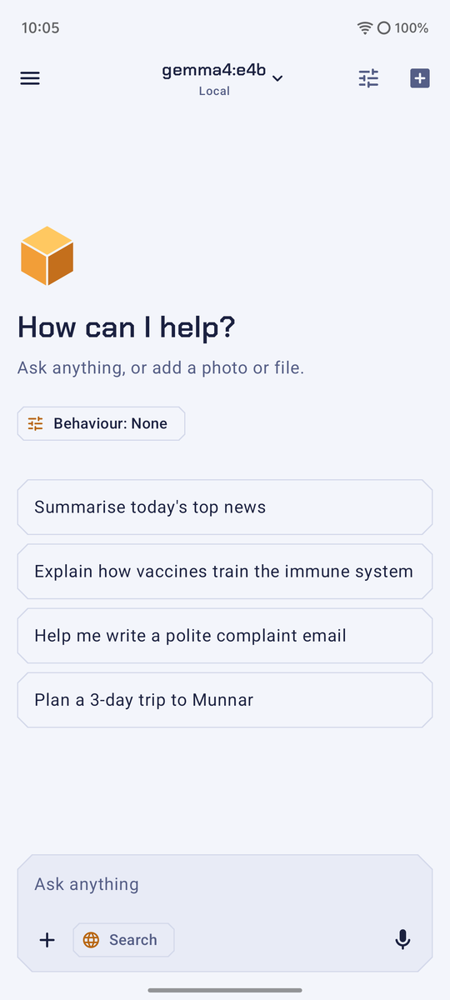

# CubicAI

A personal Android AI chat app built with Kotlin and Jetpack Compose. It talks to cloud models (Gemini, Grok, OpenRouter, any OpenAI-compatible API) and to **your own Ollama models on your PC**, through a small private gateway that only your phone can use.

<p align="center">
  
  
  
  
</p>

## Features

- **Streaming replies that fade in word by word**, with a "Thinking / Searching / Writing" status and the model's reasoning in a collapsible box.
- **Many providers in one place**: Local PC (Ollama), Google Gemini, xAI (Grok), OpenRouter, or any OpenAI-compatible endpoint. Each chat remembers its own model and behaviour.
- **Web search** with source chips: on your PC through a private SearXNG, on Grok through xAI's web and X search, on OpenRouter through its web plugin.
- **Photos, camera, files and PDFs**: images are downscaled before sending; PDFs are sent as page images, other files as text.
- **Image creation** with Gemini (needs a Google account with billing; the free tier has no image quota).
- **Context meter** beside the send button: how much of the model's context window the chat fills, plus the tokens read and written so far. Tap it for details.
- **Behaviours** (system prompts): built-in ones, your own, and an "About you" note added to all of them except None.
- **Voice input, read aloud, copy, share, edit and regenerate**, search across chats, and a light, dark or system theme.
- **Private by design**: API keys and the PC token are encrypted with an Android Keystore key, there is no account or analytics, and an optional privacy screen hides the app from the recents view and screenshots.

<p align="center">
  
  
  
  
</p>

## Install the app

You need Android 10 (API 29) or newer.

1. Build the APK (see [Build from source](#build-from-source)) or copy a `CubicAI.apk` you built earlier to the phone.
2. Install it:
   - **Over USB:** turn on *Developer options → USB debugging*, connect the phone, and run
     ```sh
     adb install -r app/build/outputs/apk/release/app-release.apk
     ```
   - **On the phone:** open the APK from Files and allow "Install unknown apps" for that app when asked.
3. Open CubicAI, tap **☰ → Settings**, and set up at least one provider (next section).

The release build is signed with the debug key, so it is for sideloading only. To update, install the new APK over the old one: your chats and settings stay.

## Set up providers

Open **Settings** and fill in the providers you want. You can then switch between them in the model picker (tap the model name at the top of a chat).

| Provider | What you need | Notes |
|---|---|---|
| **Local PC** | The CubicAI server on your PC (below), paired once | Runs your Ollama models, free and private. Web search goes through SearXNG on the PC. |
| **Google Gemini** | An API key from [Google AI Studio](https://aistudio.google.com/apikey) | Chat and photos work on the free tier. Image creation needs billing turned on. |
| **xAI (Grok)** | An API key from [console.x.ai](https://console.x.ai) | Search uses xAI's web and X search. |
| **OpenRouter** | An API key from [openrouter.ai](https://openrouter.ai/keys) | Hundreds of models; search uses OpenRouter's web plugin. |
| **Custom** | A base URL (and a key if it needs one) | Anything that speaks the OpenAI `/chat/completions` API. |

Keys are stored on the phone only, encrypted. They are never written to this repository.

## Run your own models: the PC server

The `server/` folder holds a small gateway that lets the phone use Ollama on your PC without exposing Ollama itself:

```
phone ──TLS 1.3, pinned certificate, bearer token──► cubicai_server.py :8443 ──► Ollama 127.0.0.1:11434
                                                              └──► SearXNG 127.0.0.1:8888 (web search)
```

- Only devices on your home network can connect. Tailscale connections are allowed only while **remote access** is on. Everyone else is dropped before the TLS handshake.
- The phone pins the server's self-signed certificate and sends a secret token with every request.
- Message content is never logged or stored on the PC.

### Requirements

- Linux with **Python 3** (the server uses only the standard library; it is tested on 3.14)
- [**Ollama**](https://ollama.com) with at least one model pulled, for example `ollama pull gemma4:e4b`
- Optional: **Docker** for web search, **Tailscale** to use your PC away from home, and **GTK 4 + libadwaita** (`python-gobject`) for the control panel

### 1. Set up the server

```sh
git clone https://github.com/thomasmartinoa/cubicai.git
cd cubicai/server
python3 -m venv .venv
.venv/bin/pip install qrcode        # only used to draw the pairing QR code
.venv/bin/python cubicai_server.py serve
```

The first start creates the certificate, the token and `settings.json` in `~/.config/cubicai-server` (readable only by you).

Allow the port through your firewall if you have one, for example with ufw:

```sh
sudo ufw allow 8443/tcp
```

### 2. Run it in the background (systemd)

`server/cubicai-server.service` is a sandboxed user service. It expects the repository at `~/dev_works/Model_test_harness/cubicai`, so edit the two paths in `ExecStart` if yours is elsewhere. Then:

```sh
mkdir -p ~/.config/systemd/user ~/.config/cubicai-server
cp server/cubicai-server.service ~/.config/systemd/user/
systemctl --user daemon-reload
systemctl --user enable --now cubicai-server
journalctl --user -u cubicai-server -f     # connections only, never message text
```

### 3. Pair your phone

```sh
server/.venv/bin/python server/cubicai_server.py pair
```

This prints a QR code and a `cubicai://pair?...` link. On the phone, open **Settings → Local PC** and either tap **Scan pairing QR code** or paste the link and tap **Pair**. Then tap **Test connection**.

Pair while the phone is on the same Wi-Fi as the PC. Pairing again with a fresh link is safe; `cubicai_server.py rotate` creates a new token and un-pairs every phone.

### 4. Optional: web search

Search runs through a private [SearXNG](https://docs.searxng.org) container that only listens on the PC:

```sh
mkdir -p ~/.config/cubicai-server/searxng
cat > ~/.config/cubicai-server/searxng/settings.yml <<EOF
use_default_settings: true
server:
  secret_key: "$(openssl rand -hex 32)"
  limiter: false
  image_proxy: false
  public_instance: false
search:
  formats: [html, json]
EOF
docker run -d --name cubicai-searxng --restart unless-stopped \
  -p 127.0.0.1:8888:8080 \
  -v ~/.config/cubicai-server/searxng:/etc/searxng \
  searxng/searxng
```

Then tap the **Search** chip under the message box. The server searches, reads the top pages and passes them to the model, which cites them as `[1]`, `[2]`, and so on. Page fetches are limited to public internet addresses.

### 5. Optional: use your PC away from home (Tailscale)

1. Install [Tailscale](https://tailscale.com) on the PC and the phone and sign both in to the same tailnet.
2. Turn remote access on:
   ```sh
   server/.venv/bin/python server/cubicai_server.py remote on
   ```
3. Open CubicAI once while you're at home (or tap **Test connection**). The phone learns the PC's Tailscale address by itself, so you don't need to pair again.

Away from home, the app tries your home address first and then the Tailscale one. `remote off` blocks Tailscale again straight away, including connections that are already open.

### 6. Optional: the control panel

`server/cubicai_control.py` is a GTK 4 / libadwaita panel showing server status, start/stop, the pairing QR, remote access, context length and recent activity. Run it with `python3 server/cubicai_control.py`, or add a launcher:

```sh
cat > ~/.local/share/applications/cubicai-server.desktop <<EOF
[Desktop Entry]
Type=Application
Name=CubicAI Server
Exec=/usr/bin/python3 $PWD/server/cubicai_control.py
Icon=network-server
Categories=Network;Utility;
EOF
```

### Context length

Ollama defaults to a 4K context. The gateway asks for **16K** unless the model's Modelfile sets `num_ctx`, never more than the model supports. Change it in the control panel or with `"num_ctx"` in `~/.config/cubicai-server/settings.json`. The app reads the value and shows it in the context meter.

## Build from source

Requirements: JDK 27 and the Android SDK (compileSdk 37). Gradle and the Android Gradle Plugin come with the wrapper.

```sh
echo "sdk.dir=$HOME/Android/Sdk" > local.properties   # if Android Studio hasn't made it
./gradlew assembleRelease
cp app/build/outputs/apk/release/app-release.apk CubicAI.apk
```

The app is a single `:app` module (`dev.martin.cubicai`):

| Path | What it does |
|---|---|
| `data/` | Settings and providers, encrypted secrets, chats (one JSON file each), attachments, behaviours |
| `net/LlmClient.kt` | Streaming over Server-Sent Events, web search, image creation, PC certificate pinning and address fallback |
| `ChatViewModel.kt` | App state, sending, streaming, editing, regenerating, read aloud |
| `ui/` | Compose screens, the cut-corner theme, Markdown rendering with the word fade, the context meter |
| `server/` | The PC gateway, its control panel and the systemd unit |

## Troubleshooting

| Message or symptom | What to do |
|---|---|
| **Can't reach your PC** | Check the server is running (`systemctl --user status cubicai-server`), the phone is on home Wi-Fi or Tailscale, and port 8443 is open in the firewall. |
| **Your PC turned the connection away** | You're connecting over Tailscale with remote access off. Turn it on in the panel or with `remote on`. |
| **Your PC no longer accepts this phone's pairing** | The token was rotated. Pair again with a new link. |
| **The certificate doesn't match** | The server identity was recreated. Unpair in Settings and pair again. |
| **The connection to your PC dropped before the reply finished** | The server restarted or the network dropped mid-reply. Tap **Retry**. |
| Replies pause for a few seconds and then catch up | Usually a weak Wi-Fi signal (the 2.4 GHz band is the usual culprit). Nothing is lost; the text arrives once the link recovers. |
| Gemini image creation says quota exceeded | Google's free tier has no image quota. Turn on billing for the key's project. |
| Search returns nothing on Local PC | Check the SearXNG container is running: `docker ps --filter name=cubicai-searxng`. |

## License

The Chakra Petch font is licensed under the SIL Open Font License (`licenses/ChakraPetch-OFL.txt`).
