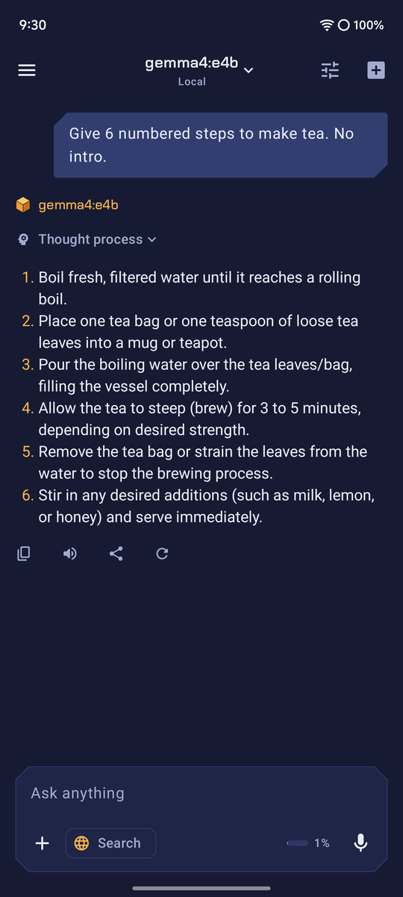
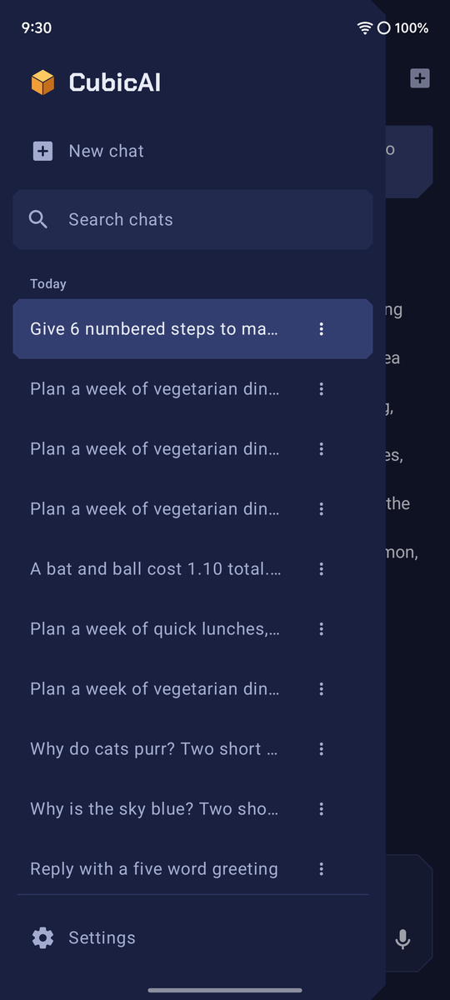
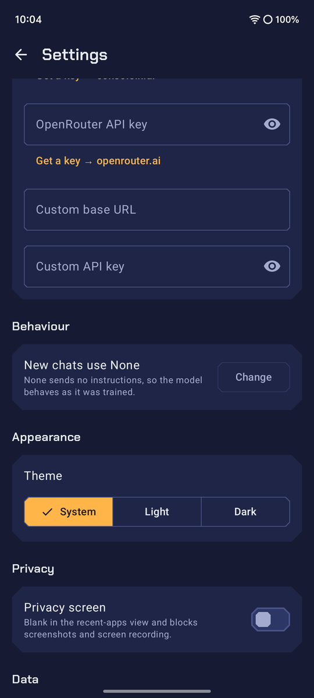
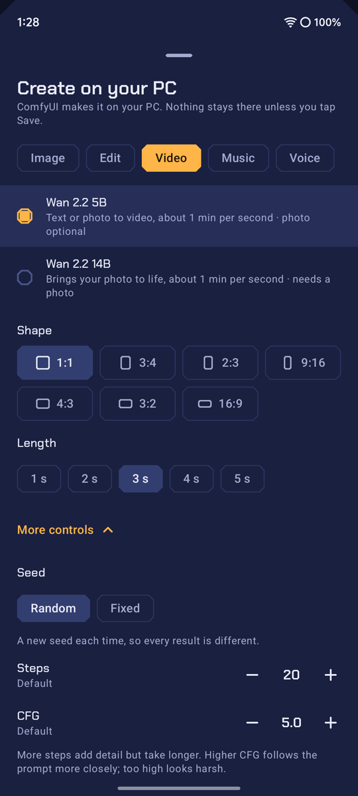
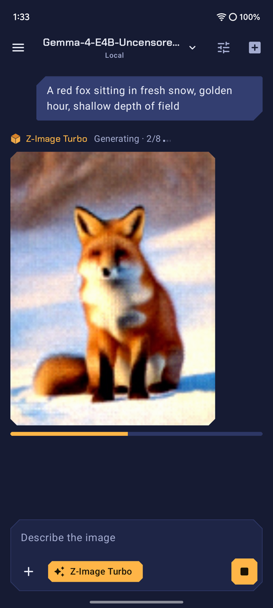
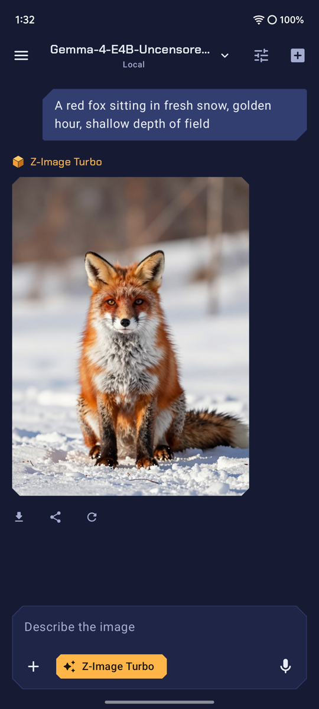
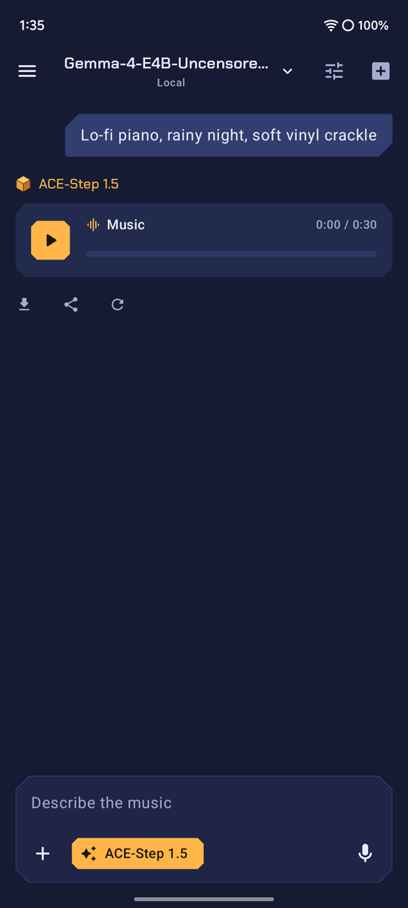

# CubicAI

A personal Android AI chat app built with Kotlin and Jetpack Compose. It talks to cloud models (Gemini, Grok, OpenRouter, any OpenAI-compatible API) and to **your own PC**: chat with your Ollama models and create images, video, music and speech with ComfyUI, through a small private gateway that only your phone can use, at home or away.

<p align="center">
  
  
  
  
</p>

## Features

- **Streaming replies that fade in word by word**, with a "Thinking / Searching / Writing" status and the model's reasoning in a collapsible box.
- **Many providers in one place**: Local PC (Ollama), Google Gemini, xAI (Grok), OpenRouter, or any OpenAI-compatible endpoint. Each chat remembers its own model and behaviour.
- **Web search** with source chips: on your PC through a private SearXNG, on Grok through xAI's web and X search, on OpenRouter through its web plugin.
- **Photos, camera, files and PDFs**: images are downscaled before sending; PDFs are sent as page images, other files as text.
- **Create images, video, music and speech on your own PC** through ComfyUI: live preview while it renders, photo edits that build on each other, a fixed seed, steps and CFG when you want them, and nothing kept on the PC unless you tap Save.
- **Image creation** with Gemini (needs a Google account with billing; the free tier has no image quota).
- **Context meter** beside the send button: how much of the model's context window the chat fills, plus the tokens read and written so far. Tap it for details.
- **Behaviours** (system prompts): built-in ones, your own, and an "About you" note added to all of them except None.
- **Voice input, read aloud, copy, share, edit and regenerate**, search across chats, and a light, dark or system theme.
- **Keeps working when the network doesn't**: falls back from home Wi-Fi to the PC's IPv6 address or Tailscale, finds the PC again when its address changes, picks a job up again after a drop or an app restart, and says plainly why it can't reach the PC.
- **Private by design**: API keys and the PC token are encrypted with an Android Keystore key, there is no account or analytics, and an optional privacy screen hides the app from the recents view and screenshots.

<p align="center">
  
  
  
  
</p>

## Install the app

You need Android 10 (API 29) or newer.

1. Build the APK (see [Build from source](#build-from-source)) or copy a `CubicAI.apk` you built earlier to the phone.
2. Install it:
   - **Over USB:** turn on *Developer options → USB debugging*, connect the phone, and run
     ```sh
     adb install -r app/build/outputs/apk/release/app-release.apk
     ```
   - **On the phone:** open the APK from Files and allow "Install unknown apps" for that app when asked.
3. Open CubicAI, tap **☰ → Settings**, and set up at least one provider (next section).

The release build is signed with the debug key, so it is for sideloading only. To update, install the new APK over the old one: your chats and settings stay.

## Set up providers

Open **Settings** and fill in the providers you want. You can then switch between them in the model picker (tap the model name at the top of a chat).

| Provider | What you need | Notes |
|---|---|---|
| **Local PC** | The CubicAI server on your PC (below), paired once | Runs your Ollama models, free and private. Web search goes through SearXNG on the PC. |
| **Google Gemini** | An API key from [Google AI Studio](https://aistudio.google.com/apikey) | Chat and photos work on the free tier. Image creation needs billing turned on. |
| **xAI (Grok)** | An API key from [console.x.ai](https://console.x.ai) | Search uses xAI's web and X search. |
| **OpenRouter** | An API key from [openrouter.ai](https://openrouter.ai/keys) | Hundreds of models; search uses OpenRouter's web plugin. |
| **Custom** | A base URL (and a key if it needs one) | Anything that speaks the OpenAI `/chat/completions` API. |

Keys are stored on the phone only, encrypted. They are never written to this repository.

## Run your own models: the PC server

The `server/` folder holds a small gateway that lets the phone use Ollama on your PC without exposing Ollama itself:

```
phone ──TLS 1.3, pinned certificate, bearer token──► cubicai_server.py :8443 ──► Ollama  127.0.0.1:11434 (chat)
                                                              ├──► SearXNG 127.0.0.1:8888  (web search)
                                                              └──► ComfyUI 127.0.0.1:8188  (create)
```

- Only devices on your home network (IPv4, or your home IPv6 prefix) can connect. Tailscale connections are allowed only while **remote access** is on. Everyone else is dropped before the TLS handshake.
- The phone pins the server's self-signed certificate and sends a secret token with every request.
- Message content is never logged or stored on the PC, and created files only until the phone has them.

### Requirements

- Linux with **Python 3** (the server uses only the standard library; it is tested on 3.14)
- [**Ollama**](https://ollama.com) with at least one model pulled, for example `ollama pull gemma4:e4b`
- Optional:
  - **Docker**, for web search
  - **Tailscale**, to use your PC away from home
  - **Avahi** (`avahi-daemon` running, plus `avahi-publish-service`, in `avahi` or `avahi-utils`), so the phone finds the PC again when the router gives it a new address
  - **ComfyUI** and an NVIDIA GPU (tested with 8 GB), for creating images, video, music and speech
  - **GTK 4 + libadwaita** (`python-gobject`), for the control panel

### 1. Set up the server

```sh
git clone https://github.com/thomasmartinoa/cubicai.git
cd cubicai/server
python3 -m venv .venv
.venv/bin/pip install qrcode        # only used to draw the pairing QR code
.venv/bin/python cubicai_server.py serve
```

The first start creates the certificate, the token and `settings.json` in `~/.config/cubicai-server` (readable only by you).

Allow the port through your firewall if you have one, for example with ufw (on the home Wi-Fi or Ethernet interface, so IPv6 is covered too; the server itself turns away anyone outside your home network):

```sh
sudo ufw allow in on wlp0s20f3 to any port 8443 proto tcp   # your interface name: ip -br link
```

### 2. Run it in the background (systemd)

`server/cubicai-server.service` is a sandboxed user service. It expects the repository at `~/dev_works/Model_test_harness/cubicai`, so edit the two paths in `ExecStart` if yours is elsewhere. Then:

```sh
mkdir -p ~/.config/systemd/user ~/.config/cubicai-server
cp server/cubicai-server.service ~/.config/systemd/user/
systemctl --user daemon-reload
systemctl --user enable --now cubicai-server
journalctl --user -u cubicai-server -f     # connections only, never message text
```

### 3. Pair your phone

```sh
server/.venv/bin/python server/cubicai_server.py pair
```

This prints a QR code and a `cubicai://pair?...` link. On the phone, open **Settings → Local PC** and either tap **Scan pairing QR code** or paste the link and tap **Pair**. Then tap **Test connection**.

Pair while the phone is on the same Wi-Fi as the PC. Pairing again with a fresh link is safe; `cubicai_server.py rotate` creates a new token and un-pairs every phone.

### 4. Optional: web search

Search runs through a private [SearXNG](https://docs.searxng.org) container that only listens on the PC:

```sh
mkdir -p ~/.config/cubicai-server/searxng
cat > ~/.config/cubicai-server/searxng/settings.yml <<EOF
use_default_settings: true
server:
  secret_key: "$(openssl rand -hex 32)"
  limiter: false
  image_proxy: false
  public_instance: false
search:
  formats: [html, json]
EOF
docker run -d --name cubicai-searxng --restart unless-stopped \
  -p 127.0.0.1:8888:8080 \
  -v ~/.config/cubicai-server/searxng:/etc/searxng \
  searxng/searxng
```

Then tap the **Search** chip under the message box. The server searches, reads the top pages and passes them to the model, which cites them as `[1]`, `[2]`, and so on. Page fetches are limited to public internet addresses.

### 5. Optional: use your PC away from home (Tailscale)

1. Install [Tailscale](https://tailscale.com) on the PC and the phone and sign both in to the same tailnet.
2. Turn remote access on:
   ```sh
   server/.venv/bin/python server/cubicai_server.py remote on
   ```
3. Open CubicAI once while you're at home (or tap **Test connection**). The phone learns the PC's Tailscale address by itself, so you don't need to pair again.

`remote off` blocks Tailscale again straight away, including connections that are already open. Right after the phone leaves Wi-Fi, Tailscale can take about a minute to reconnect; the app says so if you try during that minute.

#### How the phone reaches your PC

The app tries the PC's addresses in order, starting with the one that worked last:

1. **Home IPv4** (the address you paired with).
2. **Home IPv6.** Some routers stop passing IPv4 between two Wi-Fi devices after one reconnects (it can last 10+ minutes) while IPv6 keeps working. The PC tells the app its IPv6 home address, which can change when your provider changes its prefix, and the app falls back to it.
3. **Tailscale**, if remote access is on.

Addresses the phone can't reach right now are skipped at once (home ones without Wi-Fi, Tailscale while it's off), and the error says why. If the router gives the PC a new home address, the app finds it again over mDNS (the PC announces its certificate's fingerprint, so only your own PC is accepted) and keeps it. None of this needs pairing again.

### 6. Optional: the control panel

`server/cubicai_control.py` is a GTK 4 / libadwaita panel showing server status, start/stop, the pairing QR, remote access, context length and recent activity. Run it with `python3 server/cubicai_control.py`, or add a launcher:

```sh
cat > ~/.local/share/applications/cubicai-server.desktop <<EOF
[Desktop Entry]
Type=Application
Name=CubicAI Server
Exec=/usr/bin/python3 $PWD/server/cubicai_control.py
Icon=network-server
Categories=Network;Utility;
EOF
```

### 7. Optional: create images, video, music and speech (ComfyUI)

With [ComfyUI](https://github.com/comfyanonymous/ComfyUI) installed on the PC, the **Create** chip under the message box (Local PC only) makes things there and sends them to the phone:

| Tab | Generators (shown only when their models are installed) |
|---|---|
| Image | Qwen Image 2.1 Uncensored, Z-Image Turbo, Flux 3 Klein, Flux 2 Klein, Illustrious XL |
| Edit | Qwen Image Edit, Flux 2 Klein Edit, Remove background, Upscale 2× (attach a photo) |
| Video | Wan 2.2 5B (text or photo), Wan 2.2 14B (brings a photo to life) |
| Music | ACE-Step 1.5 (style prompt, optional lyrics) |
| Voice | Chatterbox (reads your text; attach a voice recording to copy that voice) |

<p align="center">
  
  
  
  
</p>

How it behaves:

- **Started on demand.** The server starts ComfyUI for the first job and stops it after 10 idle minutes. Ollama's models are unloaded first so the GPU has room, and ComfyUI's are freed again before the next chat.
- **Nothing piles up on the PC.** Results wait in `~/.cache/cubicai-server/media` only until the phone has downloaded them, at most an hour. Inputs and outputs inside ComfyUI's own folders are deleted after each job, and workflows run without embedded metadata.
- **Save keeps a copy in both places.** Tap **Save** on a result: it goes to the phone's Pictures, Movies or Music `/CubicAI` folder, and a copy goes to `AI_local/CubicAI/{Images,Videos,Music}` on the PC. Deleting the chat deletes everything else, and stops any job it still had running on the PC.
- **Edit, then edit again.** With an Edit generator chosen and no photo attached, the change applies to the latest picture in the chat, so you can say "now make it night" after an edit.
- **Survives the trip.** The job keeps running on the PC if the phone drops off Wi-Fi or you leave the chat. Reopening the chat picks it up again, and a job that lost the PC retries as soon as the phone is back on a network.
- **More controls when you want them.** Folded away under **More controls** in the Create sheet: a fixed **seed** (same seed and prompt give the same result, so you can change a few words and vary just that; "Use the last picture's seed" picks up the previous result's), and for Qwen Image 2.1, Illustrious and Wan 5B, **steps**, **CFG** and **Avoid** (negative prompt). They start at each workflow's own values; **Reset** goes back. The distilled models (Z-Image, Flux Klein) don't offer steps or CFG, since other values mostly spoil their results.
- **Chat and create share one GPU.** A chat sent while something is being made is slower (the PC says so); afterwards the chat model is reloaded fully onto the GPU. A second creation waits for the first. If ComfyUI crashes (out of memory, say), the reply says so and Retry starts it again.

Using it: tap **Create**, pick a generator (and shape, length or language where it applies), tap **Done**, then type what you want and send. Attach a photo for Edit and for photo-to-video, or a short voice recording for Chatterbox to copy. The result arrives in the chat with **Save**, **Share** and **Regenerate**.

Setup (paths in the unit files assume ComfyUI at `/mnt/storage/games/AI_local/ComfyUI`; edit them if yours is elsewhere):

```sh
cp server/cubicai-comfyui.service server/cubicai-server.service ~/.config/systemd/user/
mkdir -p /mnt/storage/games/AI_local/ComfyUI/{input,output}/cubicai /mnt/storage/games/AI_local/CubicAI
systemctl --user daemon-reload
systemctl --user restart cubicai-server
```

`cubicai-comfyui.service` starts ComfyUI with a launcher script (`ExecStart`); point it at your own start command. The gateway's unit may only write to the folders above, so change its `ReadWritePaths` too if yours differ.

The workflows are the ones saved in ComfyUI's `user/default/workflows`; `server/cubicai_media.py` lists which file each generator uses and which inputs it sets. A generator shows up in the app only when its workflow file and all its models are present.

### Context length

Ollama defaults to a 4K context. The gateway asks for **16K** unless the model's Modelfile sets `num_ctx`, never more than the model supports. Change it in the control panel or with `"num_ctx"` in `~/.config/cubicai-server/settings.json`. The app reads the value and shows it in the context meter.

## Build from source

Requirements: JDK 27 and the Android SDK (compileSdk 37). Gradle and the Android Gradle Plugin come with the wrapper.

```sh
echo "sdk.dir=$HOME/Android/Sdk" > local.properties   # if Android Studio hasn't made it
./gradlew assembleRelease
cp app/build/outputs/apk/release/app-release.apk CubicAI.apk
```

The app is a single `:app` module (`dev.martin.cubicai`):

| Path | What it does |
|---|---|
| `data/` | Settings and providers, encrypted secrets, chats (one JSON file each), attachments, behaviours |
| `net/LlmClient.kt` | Streaming over Server-Sent Events, web search, image creation, PC certificate pinning and address fallback |
| `net/MediaClient.kt`, `net/LanFinder.kt` | Jobs on the PC (submit, follow, download, save); finding the PC again over mDNS |
| `ChatViewModel.kt` | App state, sending, streaming, editing, regenerating, creating, reconnecting, read aloud |
| `ui/` | Compose screens, the cut-corner theme, Markdown rendering with the word fade, the context meter, the Create sheet and media players |
| `server/cubicai_server.py` | The gateway: pairing, address checks, Ollama, web search |
| `server/cubicai_media.py`, `server/comfy_workflow.py` | ComfyUI jobs: generators, starting and stopping ComfyUI, sharing the GPU, turning saved workflows into API prompts |
| `server/cubicai_control.py`, `server/*.service` | The control panel and the systemd units |

## Troubleshooting

| Message or symptom | What to do |
|---|---|
| **Can't reach your PC** | Check the server is running (`systemctl --user status cubicai-server`), the phone is on home Wi-Fi or Tailscale, and port 8443 is open in the firewall. |
| **Your PC is there but CubicAI Server isn't answering** | The PC is reachable but the server is stopped. Start it from the panel or with `systemctl --user start cubicai-server`. |
| **You're not on your home Wi-Fi and Tailscale is off** | Turn Tailscale on in its app (and remote access on the PC), or get back on home Wi-Fi. |
| **Can't reach your PC through Tailscale** | Right after leaving Wi-Fi Tailscale needs about a minute; try again. If it keeps happening, check the PC is online in the Tailscale app. |
| **Your PC turned the connection away** | You're connecting over Tailscale with remote access off. Turn it on in the panel or with `remote on`. |
| **Your PC no longer accepts this phone's pairing** | The token was rotated. Pair again with a new link. |
| **The certificate doesn't match** | The server identity was recreated. Unpair in Settings and pair again. |
| **The connection to your PC dropped before the reply finished** | The server restarted or the network dropped mid-reply. Tap **Retry**. |
| Replies pause for a few seconds and then catch up | Usually a weak Wi-Fi signal (the 2.4 GHz band is the usual culprit). Nothing is lost; the text arrives once the link recovers. |
| Gemini image creation says quota exceeded | Google's free tier has no image quota. Turn on billing for the key's project. |
| A creation says **Reconnecting to your PC** | The phone lost the PC (Wi-Fi dropped, PC asleep). The job keeps running there and is picked up as soon as the phone is back on a network. |
| **ComfyUI stopped while making this** | ComfyUI crashed, usually out of GPU memory (a long video, say). Tap **Retry**; it starts ComfyUI again. |
| **Your PC lost track of this one** | The server restarted, or the result waited more than an hour without being downloaded. Tap **Retry** to make it again. |
| A chat is slow while something is being made | Chat and ComfyUI share the GPU. The reply says the PC is busy; chat is back to full speed once the creation is done. |
| **Create** shows nothing to make | ComfyUI isn't installed where the unit file expects it, or none of the listed models are present. Check `journalctl --user -u cubicai-comfyui`. |
| A creation fails with "ComfyUI rejected the workflow" | A model or custom node the workflow uses is missing or was renamed. Open the workflow in ComfyUI to see which. |
| Search returns nothing on Local PC | Check the SearXNG container is running: `docker ps --filter name=cubicai-searxng`. |

## License

The Chakra Petch font is licensed under the SIL Open Font License (`licenses/ChakraPetch-OFL.txt`).
